# TV Home

**Un ecran principal în stilul Apple TV pentru televizoarele TCL cu Google TV**: Liquid Glass,
animații fluide, previzualizări din aplicațiile tale, Control Center, căutare în aplicațiile de
streaming, un Mod Cinema care te ajută să alegi un film, notificări cu vremea și alertele meteo,
mesaje și întrebări de pe calculator (făcute pentru un asistent AI care lucrează cât te uiți la
televizor), plus un instrument care curăță televizorul.

[English](README.md)

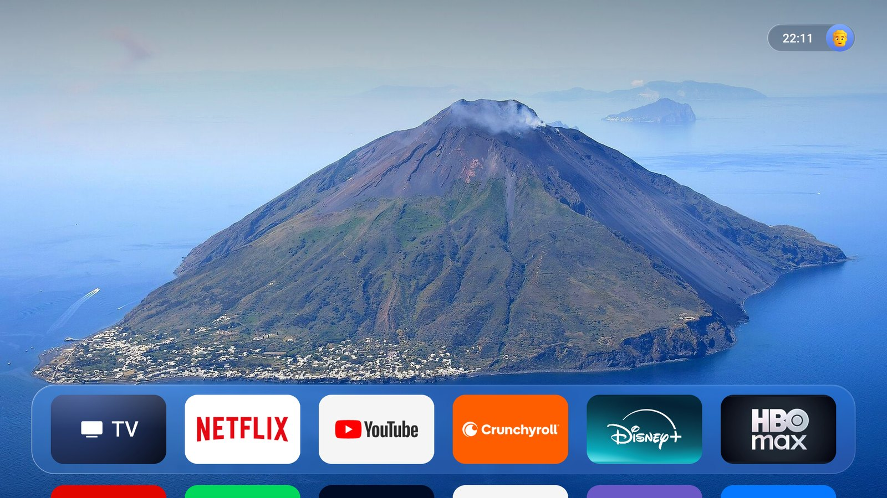

> **Deocamdată doar pentru televizoare TCL.** TV Home a fost făcut și testat pe un TCL cu Google TV și
> Android TV 12 (4K, Europa). Se bazează pe felul în care se comportă sistemul TCL (paginile de setări,
> sursele, managerul de energie), așa că pe alte mărci unele părți nu vor merge. E un proiect personal,
> fără legătură cu Apple, TCL sau Google.
>
> **Open source și încă neșlefuit pe alocuri.** Are buguri; se pot rezolva. Issue-urile și pull
> request-urile sunt binevenite.

---

## Cuprins

- [Ce face](#ce-face)
- [De ce ai nevoie](#de-ce-ai-nevoie)
- [Instalare](#instalare)
- [Cum îl folosești cu telecomanda](#cum-îl-folosești-cu-telecomanda)
- [Setări](#setări)
- [Actualizare și anularea tuturor schimbărilor](#actualizare-și-anularea-tuturor-schimbărilor)
- [Confidențialitate: cu ce comunică](#confidențialitate-cu-ce-comunică)
- [Permisiuni](#permisiuni)
- [Probleme frecvente](#probleme-frecvente)
- [Compilare](#compilare)
- [Structura proiectului](#structura-proiectului)
- [Mulțumiri și licențe](#mulțumiri-și-licențe)

---

## Ce face

### hello

Când pornește televizorul, „hello” iese din blur, argintiu, peste fundalul tău, cu un sunet discret,
apoi apare ecranul principal: bara urcă, iar aplicațiile se aprind pe rând.

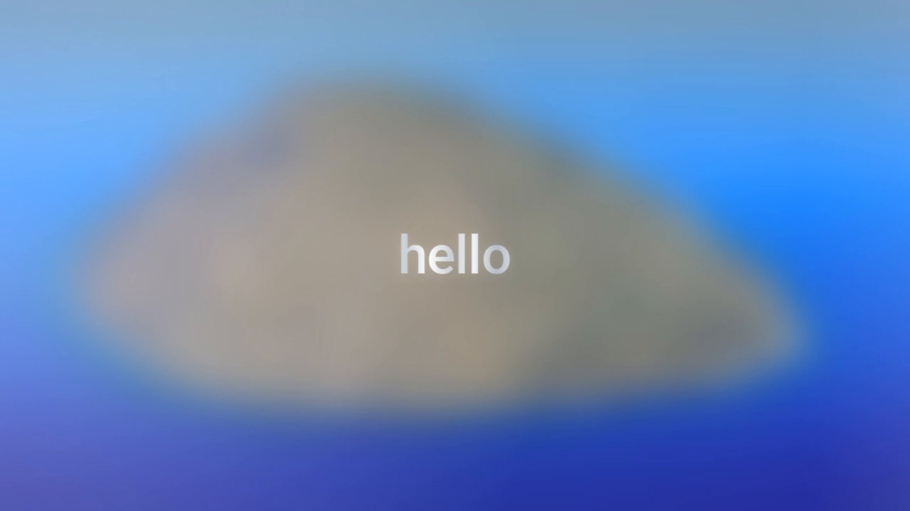

### Ecranul principal

- **Fundaluri**: fotografii cu natură care se schimbă la câteva minute, cu trecere lentă; poți pune și
  pozele tale.
- **Bara (dock)**: aplicațiile preferate pe un panou de Liquid Glass. Selecția ridică aplicația, o
  înclină puțin și o luminează; la OK se adâncește.
- **Previzualizări**: când stai pe o aplicație, ultimele ei programe urcă deasupra barei, sub formă de
  carduri (Netflix, YouTube, Disney+, HBO Max și orice aplicație care publică canale Android TV).
  Filtre sus: *Pentru tine*, *Continuă*, *Top 10*, *Seriale*, *Filme*.
- **Cardul TV**: canalele de pe antenă ca niște carduri, primul rulând fără sunet.
- **Toate aplicațiile**: apeși Jos și apar toate, într-o grilă peste fundalul estompat; le poți grupa în
  foldere.
- **Aranjare**: ții apăsat OK pe o aplicație, apoi o muți la stânga sau la dreapta.

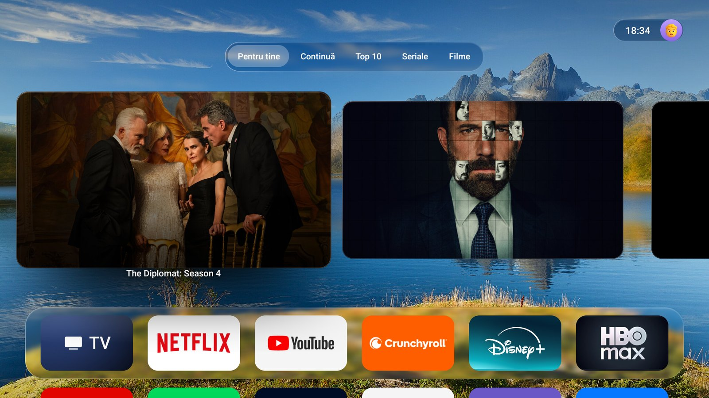

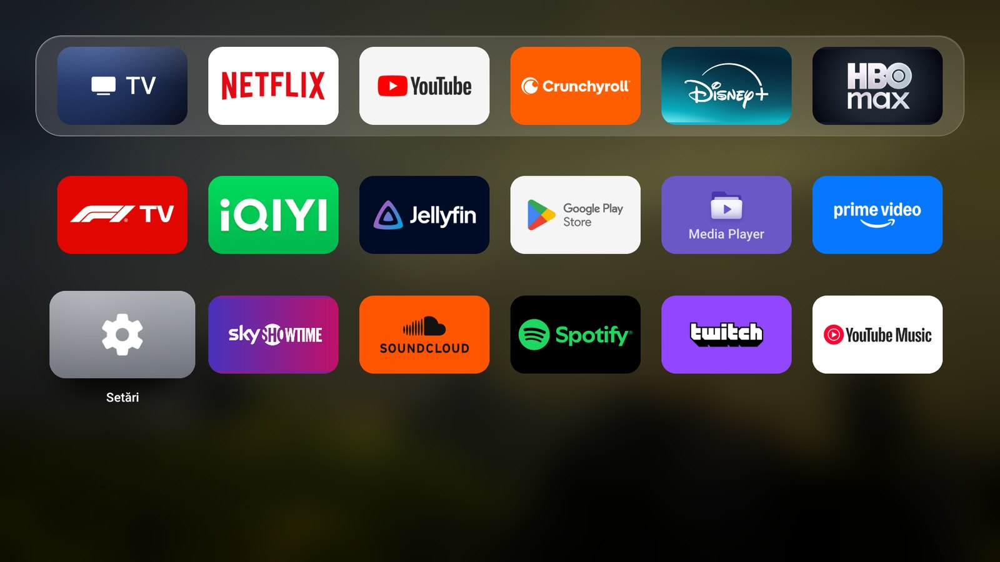

### Control Center

Apeși Sus din partea de sus a ecranului (sau alegi ceasul). Plăci de sticlă și scurtături rotunde, ca
pe tvOS:

- **Cinema** (mai jos), **Wi-Fi** și **Bluetooth**, care se deschid într-o listă de rețele sau dispozitive;
- **Nu deranja**: fără notificări cât e pornit (alertele meteo roșii trec totuși);
- **Somn**: alegi ora și minutul la care se oprește singur televizorul; cu un minut înainte, te anunță;
- **Scurtături**: Caută, Surse, Antenă, toate aplicațiile, fundalul următor, setări de imagine și sunet,
  accesibilitate, Setări, camere, Google Play, screensaver. Ții apăsat OK pe una ca să o muți sau să o
  scoți, **+** adaugă una;
- **Surse** (HDMI, antenă) și **Profiluri**, pe tab-urile lor.

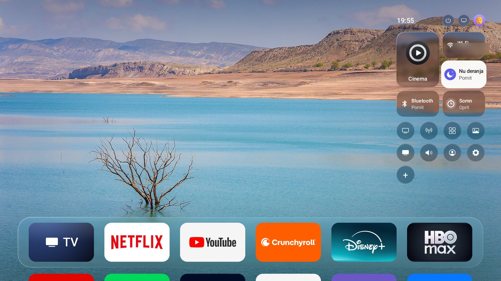

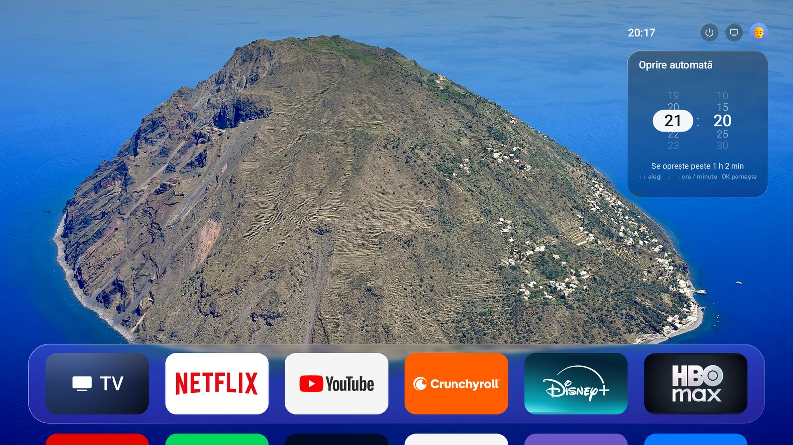

### Notificări

Vremea și notificările vin ca niște picături de Liquid Glass care ies din marginea din stânga a
ecranului, peste orice te uiți (în afară de Mod Cinema), cu un „clink” discret de sticlă:

- **Vremea**: când pornește televizorul și când se schimbă cerul (începe ploaia, trece furtuna), cu vremea
  mișcându-se în spatele sticlei: ploaie, ninsoare, fulgere, soare. Verifică din nou la momentul în care
  prognoza spune că se schimbă cerul, altfel la fiecare jumătate de oră.
- **Alerte**: codurile galben, portocaliu și roșu pentru județul tău (România, de la MeteoAlarm).
- **Notificările aplicațiilor** (opțional, vezi [Instalare](#7-extra-opțional)).
- **Mesaje de pe calculator**: vezi [mai jos](#mesaje-și-întrebări-de-pe-calculator).

Mai multe deodată se așază una sub alta și își fac loc fluid când vin și pleacă; când n-ar mai
încăpea pe ecran, pleacă cea mai veche. Pe ecranul principal, **Stânga** la marginea din stânga
intră cu telecomanda în ele: **Sus / Jos** treci de la una la alta (cea pe care ești vine în față și
se deschide cu tot textul), **Back** o închide, **Dreapta** ieși. Cât ești în ele, niciuna nu pleacă
singură.

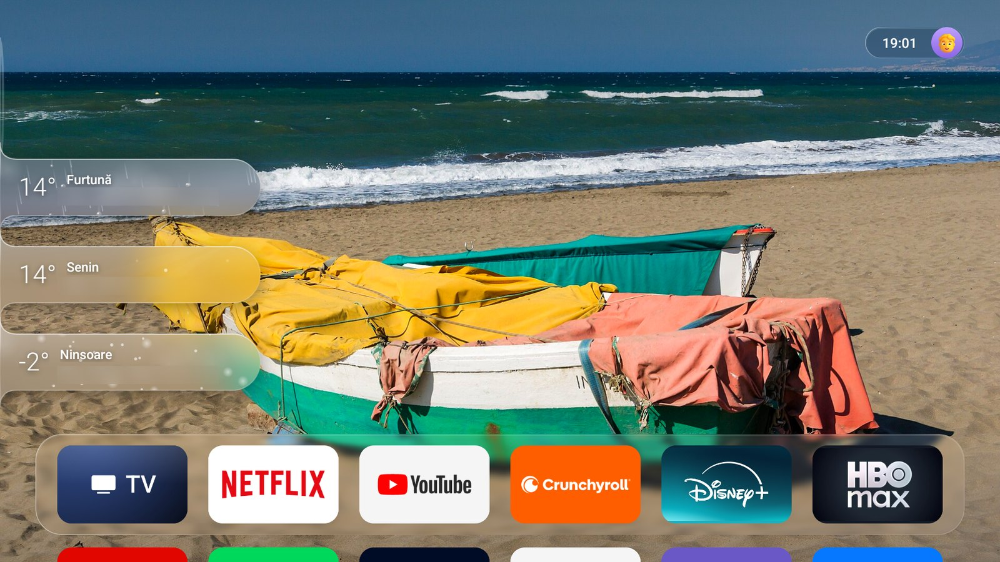

### Mesaje și întrebări de pe calculator

Făcute pentru un asistent AI (Claude) care lucrează pe calculator cât tu te uiți la televizor, ca
să-l urmărești și să-i răspunzi de pe canapea; orice script le poate folosi.

- **Mesajele** ies din marginea din stânga ca o picătură mică de Liquid Glass, cu semnul Claude și
  titlul, care apoi se deschide, în lățime și în jos, cu textul și detaliile (rândurile care încep cu
  `- ` sunt o listă, `**cuvinte**` sunt îngroșate).
- **Clawd**, mascota în pixeli a Claude Code, aterizează pe marginea de sus și face altceva la fiecare
  mesaj: face cu mâna, sare cu ochii fericiți când ceva e gata, aruncă confetti, se plimbă sub un
  semn de întrebare cât așteaptă o întrebare, ține mâinile sus când are nevoie de tine, lucrează sub
  semnul Claude care se rotește, trimite o inimă sau doarme. E ales după cuvinte (sau cu `--mood`)
  și nu e același de două ori la rând.
- **Întrebările** au răspunsurile ca butoane de sticlă: alegi unul cu telecomanda sau scanezi codul
  QR și răspunzi de pe telefon (cât așteaptă întrebarea, televizorul servește o pagină mică în rețeaua
  de acasă). Calculatorul primește răspunsul.
- **Sarcini**: o listă scurtă sub vreme când pornește televizorul (întâi vremea, apoi se deschide în
  jos spre listă), cu bife din Liquid Glass care se umplu pe măsură ce lucrurile sunt gata.
- **Consum**: o pastilă mică de sticlă în stânga sus pe ecranul principal, cu cât e folosit din plan și
  când se reface. Apare doar pe ecranul principal și urcă din drum cât sunt notificări.
- **Un cont pe profil**: fiecare calculator care vorbește cu televizorul e un cont. În Control Center,
  cercul Claude alege ce cont vede profilul în uz, sau niciunul. Celelalte profiluri nu văd nimic;
  mesajele lor așteaptă până e în uz un profil legat de ele.

```bash
python tvtool.py claude --name "Ana"                       # numele contului acestui calculator
python tvtool.py say "Backup gata" "Totul e bine" --details $'- 120 GB copiați\n- **fără erori**'
python tvtool.py ask "Public acum?" --options "Da|Încă nu"  # afișează răspunsul
python tvtool.py tasks --add "Reînnoiesc domeniul" --done 1 # lista de sub vreme
python tvtool.py usage 18 --resets "se reface la 02:20"     # pastila din stânga sus
```

Merge și un broadcast simplu, din orice script:

```bash
adb shell am broadcast -n ro.tinulica.tvhome/.MessageReceiver --es title "Backup gata" --es text "Totul e în regulă"
```

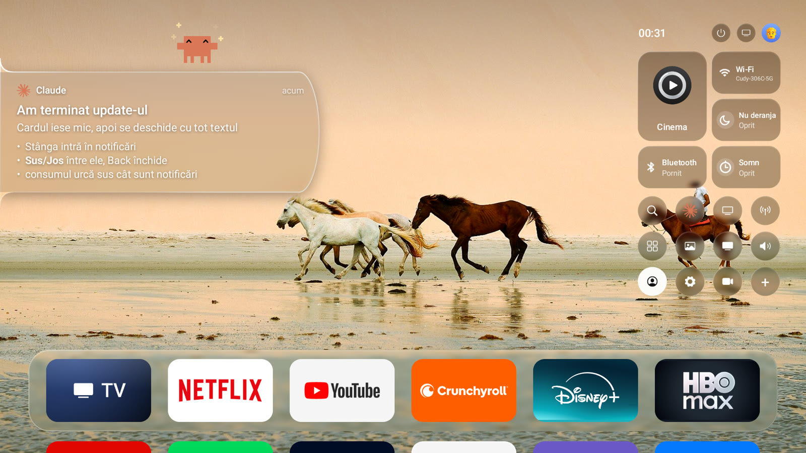

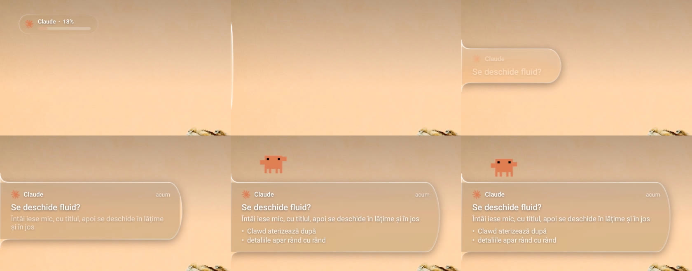

### Căutare

Un câmp de căutare și o tastatură din sticlă peste ecranul principal estompat. Scrii (sau spui, unde
televizorul poate) și primești filme și seriale ca niște carduri, cele de pe aplicațiile tale primele, cu
numele aplicației pe fiecare. OK deschide titlul în aplicația lui, pe pagina lui (Netflix, Disney+, HBO
Max, Prime Video); *Trailer* îl pornește pe YouTube. Are nevoie de o cheie TMDB gratuită
([pasul 8](#8-căutare-și-mod-cinema-opțional)).

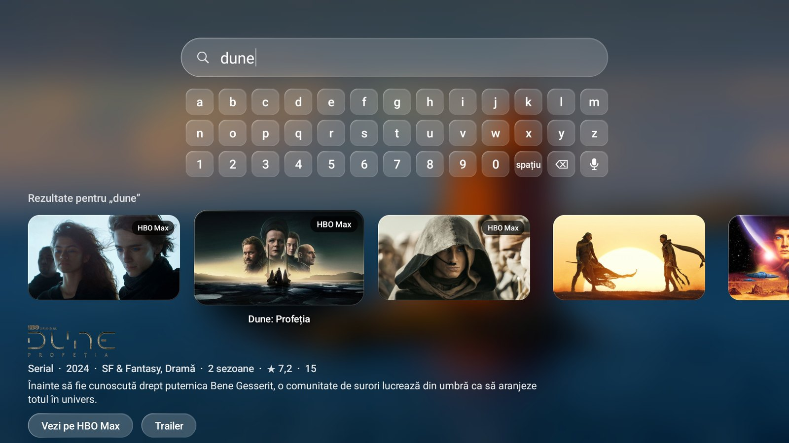

### Profiluri

Mai multe persoane, fiecare cu nume, imagine și ordinea ei de aplicații în bară. Ții apăsat OK pe un
profil în Control Center ca să-i schimbi numele sau imaginea.

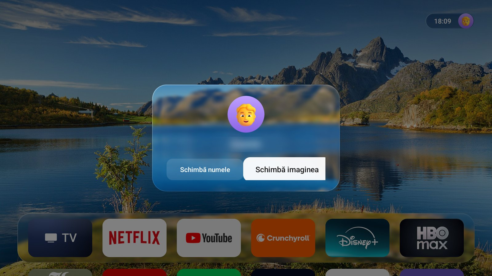

### Scurtături pe telecomandă

- **Back ținut apăsat**: se umple un cerc; dai drumul și apar aplicațiile deschise recent. Sus pe una o
  închide.
- **Volum**: o bară de volum din sticlă în locul celei a televizorului.
- **Butonul de surse**: un panou de surse din sticlă.

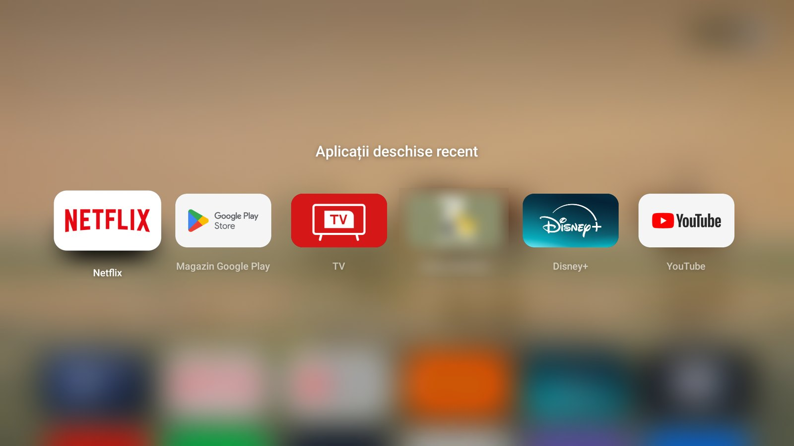

### Mod Cinema

Un ecran întreg care te ajută să găsești ce să vezi în seara asta. Se sting luminile, cu o coloană
sonoră, urmează câteva întrebări (cine se uită, film sau serial, ce chef aveți, cât timp aveți, ceva nou
sau un clasic), apoi rezultatele pe abonamentele pe care le ai, cu trailere, detalii și *Vezi pe …*,
care deschide titlul în aplicația lui. Tab-uri: *Pentru voi*, *Populare acum*, *Altă alegere*,
*Abonamente*. Are nevoie de o cheie TMDB.

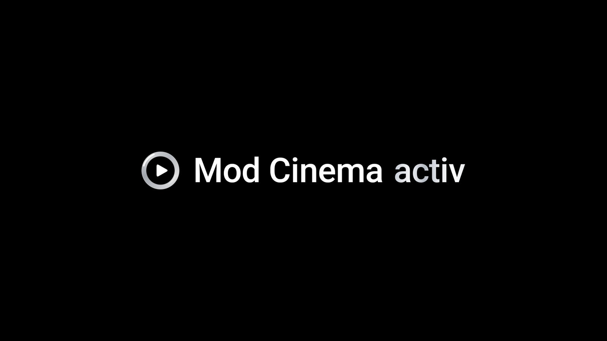

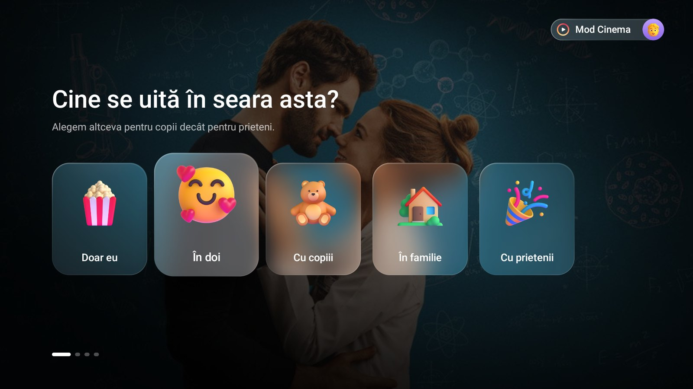

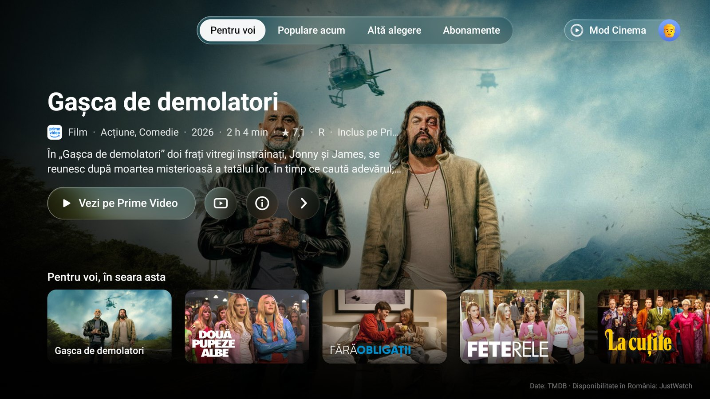

### Curățarea televizorului

`tvtool.py debloat` oprește reclamele, telemetria și aplicațiile inutile de la TCL și Google. Te întreabă
la fiecare aplicație, doar o **dezactivează** (nu dezinstalează nimic), notează fiecare schimbare în
`tv-data/changes.json` și poate anula totul. Chromecast, antena / Live TV, Google Play, Setările,
tastaturile, HDMI-CEC, Bluetooth, actualizările de sistem și aplicațiile din bară nu sunt propuse
niciodată.

---

## De ce ai nevoie

- Un **televizor TCL cu Google TV** (Android TV 12 sau mai nou) în rețeaua de acasă.
- Un calculator (Windows, macOS sau Linux) cu **Python 3.9 sau mai nou**, în aceeași rețea.
- Cam 15 minute.
- Opțional: un cont **TMDB** gratuit, pentru Căutare și Mod Cinema.

---

## Instalare

### 1. Pornește opțiunile pentru dezvoltatori pe televizor

1. **Setări › Sistem › Despre**: alege **Versiune sistem de operare Android TV** și apasă OK de
   **7 ori**, până îți spune că ești dezvoltator.
2. **Setări › Sistem › Opțiuni pentru dezvoltatori**: pornește **Depanare USB** (pe TCL permite și
   depanarea prin rețea).

### 2. Descarcă instrumentul

```bash
git clone https://github.com/tinulica/tv-home.git
cd tv-home
python -m pip install -r requirements.txt
```

Instrumentul folosește pachetul `adb-shell`, scris în Python, deci nu ai nevoie de programul `adb` de
la Android. Dacă îl ai, îl poți folosi cu `--backend adb`.

### 3. Găsește televizorul și conectează-te

```bash
python tvtool.py find        # caută televizorul în rețea
python tvtool.py connect     # apoi alege „Permite întotdeauna” pe televizor și apasă OK
```

Dacă `find` nu îl vede, dă adresa televizorului (pe televizor: **Setări › Rețea și internet**):

```bash
python tvtool.py connect 192.168.x.y
```

### 4. Backup

```bash
python tvtool.py backup
```

Salvează lista de aplicații, setările și ecranul principal actual în `tv-data/backups/` pe calculator.
Nimic din `tv-data/` nu pleacă de pe calculator (git îl ignoră).

### 5. Curățare (opțional)

```bash
python tvtool.py scan        # arată ce s-ar putea opri; nu schimbă nimic
python tvtool.py debloat     # întreabă la fiecare aplicație; Enter = recomandarea
```

### 6. Instalează TV Home

```bash
python tvtool.py launcher
```

Instalează `dist/tv-home.apk`, pune aplicațiile de streaming în bară, face din TV Home ecranul principal
și verifică dacă butonul Home îl aduce înapoi din interiorul unei aplicații (dacă nu, revine la ecranul
principal vechi).

### 7. Extra (opțional)

```bash
python tvtool.py surse        # Back ținut, bara de volum, notificările, panoul de surse
python tvtool.py notificari   # notificările aplicațiilor ca picături de sticlă
python tvtool.py wallpapers   # mai multe fundaluri cu natură (--seconds 300 = cât stă fiecare)
```

`surse` pornește serviciul de accesibilitate al TV Home și îl lasă să-l țină pornit (playerele TCL opresc
uneori accesibilitatea). `notificari` îi dă acces la notificări. Le oprești cu `--off` sau din Setările
televizorului.

### 8. Căutare și Mod Cinema (opțional)

1. Fă-ți un cont gratuit pe [themoviedb.org](https://www.themoviedb.org/signup), apoi în
   **Settings › API** cere o cheie API (uz personal).
2. Rulează:

   ```bash
   python tvtool.py tmdb
   ```

   și lipește *API Read Access Token* (sau cheia API) când ți se cere. Nu apare pe ecran, se salvează doar
   în `tv-data/tmdb.key` pe calculator și în spațiul privat al TV Home pe televizor și nu e scrisă
   niciodată în cod. `--new` o înlocuiește.

### 9. Personalizare (opțional)

```bash
python tvtool.py dock com.netflix.ninja,com.google.android.youtube.tv   # aplicațiile din bară
python tvtool.py folder Jocuri com.exemplu.unu,com.exemplu.doi         # un folder în grilă
python tvtool.py profile eu.jpg --name "Alex"                          # profilul curent
python tvtool.py sounds sunetele-mele/                                 # sunete de navigare proprii
python tvtool.py cameras add "Ușa" rtsp://camera.local/stream           # o cameră în Control Center
python tvtool.py shot acasa                                            # o captură de ecran
```

`python tvtool.py -h` arată toate comenzile, iar `python tvtool.py <comandă> -h` opțiunile fiecăreia.

### 10. Mesaje de pe calculator (opțional)

```bash
python tvtool.py claude --name "Ana"            # calculatorul devine un cont pe televizor
python tvtool.py say "Salut de pe calculator"   # un prim mesaj
```

Primul profil vede primul cont până alege; orice profil își alege contul în Control Center (cercul
Claude). Ca să-l folosească un asistent AI, spune-i să ruleze `tvtool say` când termină ceva sau are
nevoie de tine și `tvtool ask` când are nevoie de un răspuns (comanda așteaptă și afișează
răspunsul). Codurile QR au nevoie de `segno` (e în `requirements.txt`).

---

## Cum îl folosești cu telecomanda

| Unde | Buton | Ce se întâmplă |
|---|---|---|
| Acasă | Stânga / Dreapta | Te miști prin bară; previzualizările urcă după o clipă |
| Acasă | Sus | În previzualizări; încă o dată: filtrele; încă o dată: Control Center |
| Acasă | Jos | Toate aplicațiile |
| Pe o aplicație | OK ținut apăsat | O muți cu Stânga / Dreapta; OK sau Back o lasă acolo |
| Oriunde | Back ținut apăsat | Aplicațiile recente (dai drumul când s-a umplut cercul); Sus pe una o închide |
| Oriunde | Volum | Bara de volum din sticlă |
| Acasă, cu notificări | Stânga la marginea din stânga | În notificări: Sus / Jos între ele, Back închide una, Dreapta ieși |
| O întrebare de pe calculator | Sus / Jos, OK | Alegi un răspuns; Back o închide fără răspuns |
| Control Center | OK pe cercul Claude | Mesajele cărui calculator le vede profilul |
| Control Center | OK ținut pe o scurtătură | O muți sau o scoți; **+** adaugă una |
| Control Center | OK / OK ținut pe un profil | Treci pe el / îl editezi |
| Căutare | Litere, OK, Jos | Scrii; rezultatele; *Vezi pe …* și *Trailer* |
| Mod Cinema | Home | Te întreabă înainte să ieși din Mod Cinema |

---

## Setări

Deschizi **Setări** din Control Center (rotița) sau din grila de aplicații. Printre ele: notificările cu
vremea, alertele meteo, sunetul notificărilor, animația hello, fundalurile încorporate, sunetele de
navigare și scurtături spre setările televizorului.

---

## Actualizare și anularea tuturor schimbărilor

```bash
git pull
python tvtool.py update                    # instalează noul dist/tv-home.apk, păstrează bara
python tvtool.py restore                   # repornește aplicațiile oprite, revine la ecranul principal vechi
python tvtool.py restore --uninstall-home  # ... și dezinstalează TV Home
```

`tv-data/restore.bat` și `tv-data/restore.sh` fac același lucru cu programul `adb`. O resetare la
setările din fabrică aduce și ea totul înapoi.

După o actualizare, apasă o dată **Home**: TCL lasă serviciul TV Home să pornească din nou doar după ce
TV Home a fost pe ecran.

---

## Confidențialitate: cu ce comunică

TV Home nu are cont, statistici sau server propriu. Se conectează la:

| Serviciu | Pentru ce | Ce trimite |
|---|---|---|
| [TMDB](https://www.themoviedb.org) | Căutare, Mod Cinema, postere | Cuvintele căutate și cheia ta TMDB |
| [Wikidata](https://www.wikidata.org) | ID-urile titlurilor în aplicații (ca să le deschidă direct) | ID-ul TMDB al titlului |
| Pagina Top 10 Netflix | Top 10 Netflix în previzualizări | Nimic personal |
| [Open-Meteo](https://open-meteo.com) | Vremea | Coordonatele aproximative |
| [ipwho.is](https://ipwho.is) | Orașul aproximativ, cel mult o dată pe zi | Adresa IP publică (ca la orice cerere) |
| [MeteoAlarm](https://meteoalarm.org) | Alertele meteo pentru România | Nimic personal |
| YouTube / Vimeo | Trailere | ID-ul trailerului |

Restul (profilurile, bara, alegerile tale) rămâne pe televizor. `tvtool` comunică doar cu televizorul tău.
Cât așteaptă o întrebare de pe calculator, televizorul răspunde pe portul 8642 în rețeaua de acasă
(pagina pe care o deschide codul QR); se închide odată cu întrebarea.

---

## Permisiuni

| Permisiune | De ce |
|---|---|
| Internet, starea Wi-Fi | Serviciile de mai sus; numele și lista rețelelor în Control Center |
| Bluetooth | Lista Bluetooth din Control Center |
| Locație (dată de `tvtool`) | Android o cere ca să listeze rețelele Wi-Fi |
| Statistici de utilizare, oprirea proceselor | Aplicațiile recente și închiderea lor |
| Programul TV, EPG | Canalele de pe antenă din cardul TV |
| Scrierea setărilor securizate (dată de `tvtool surse`) | Ca să țină pornit serviciul de accesibilitate când TCL îl oprește |
| Serviciul de accesibilitate (îl pornești tu) | Back ținut, bara de volum, notificările peste alte aplicații |
| Acces la notificări (îl pornești tu) | Notificările aplicațiilor ca picături |

---

## Probleme frecvente

- **Back ținut, bara de volum sau notificările nu mai merg**: apasă o dată Home. Playerele TCL pot opri
  accesibilitatea, iar după o actualizare TCL lasă serviciul să pornească doar din ecranul principal.
- **Televizorul nu e găsit**: televizorul și calculatorul trebuie să fie în aceeași rețea, cu depanarea
  USB pornită; încearcă `python tvtool.py connect <adresa televizorului>`.
- **Nu a apărut „Permite întotdeauna”**: scoate televizorul din priză 10 secunde, apoi `connect` din nou.
- **Netflix se deschide la alegerea profilului, nu la titlu**: alege profilul; TV Home trimite titlul din
  nou imediat după.
- **Căutarea sau Mod Cinema cer o cheie**: `python tvtool.py tmdb`.
- **Ceva nu arată bine după o actualizare**: `python tvtool.py restore`, apoi din nou `launcher`.
- **Un mesaj de pe calculator nu apare**: profilul în uz nu e legat de contul acelui calculator
  (Control Center, cercul Claude); apare când e în uz un profil legat. Cât serviciul e oprit (vezi
  primul punct) vine ca un mesaj simplu de sistem.
- **Telefonul nu deschide pagina întrebării**: telefonul trebuie să fie în aceeași rețea cu televizorul.

---

## Compilare

Aplicația e scrisă în Java, fără biblioteci, și se compilează fără Gradle. Ai nevoie de **JDK 17+** și
de **Android SDK** cu `platforms;android-34` și `build-tools;35.0.0`:

```bash
ANDROID_HOME=~/android-sdk launcher/build.sh     # scrie dist/tv-home.apk
```

Prima compilare face o cheie de semnare în `~/.android/tvhome.keystore` (sau la `TVHOME_KEYSTORE`).
Păstreaz-o: Android acceptă o actualizare doar dacă e semnată cu aceeași cheie.

Sunetele sunt făcute de scripturile din `tools/` (`python tools/hello_sound.py` și celelalte).

Testele folosesc un televizor simulat și verifică că nu se dezinstalează nimic, că aplicațiile protejate
nu sunt propuse niciodată, că restore anulează totul și că un test eșuat al butonului Home revine la
starea de dinainte:

```bash
python -m pytest tests
```

---

## Structura proiectului

```
tvtool.py          instrumentul din linia de comandă: conectare, backup, curățare, instalare, restore, ...
catalog.py         pachetele cunoscute de la TCL / Google TV și ce face fiecare
launcher/          TV Home, aplicația Android
  src/             sursele Java: MainActivity (ecranul principal), SourcesService (serviciul de
                   accesibilitate: notificări, Back ținut, volum), CinemaActivity, LiquidDrop,
                   ClaudeCard, Clawd, ClaudeLink (conturi pe profil), QuestionServer (răspunsuri de
                   pe telefon), ...
  assets/          fundaluri, sunete, avatare, imaginile din Mod Cinema
  build.sh         scriptul de compilare
dist/tv-home.apk   aplicația compilată
tools/             scripturile care fac sunetele
tests/             testele pentru tvtool
docs/              imaginile de aici și note despre cum e desenat Liquid Glass
```

---

## Mulțumiri și licențe

- **Fundaluri**: Wikimedia Commons (CC BY-SA și CC0); autorii și licențele în
  [launcher/assets/wallpapers/CREDITS.txt](launcher/assets/wallpapers/CREDITS.txt). Unele au fost alese de
  [mihirgupta0900/tv-home](https://github.com/mihirgupta0900/tv-home) (MIT), care a inspirat și meniul de
  surse și lista de pachete TCL.
- **Imaginile din Mod Cinema și avatarele**: [Fluent Emoji](https://github.com/microsoft/fluentui-emoji)
  de la Microsoft (MIT, vezi [launcher/assets/FLUENT-EMOJI-LICENSE.txt](launcher/assets/FLUENT-EMOJI-LICENSE.txt)).
- **Pictograme**: vezi [launcher/ICONS-LICENSE.txt](launcher/ICONS-LICENSE.txt) (MIT).
- **Date despre filme și seriale**: [TMDB](https://www.themoviedb.org). *This product uses the TMDB API but
  is not endorsed or certified by TMDB.*
- **Vremea**: [Open-Meteo](https://open-meteo.com) (CC BY 4.0). **Alerte**: MeteoAlarm / EUMETNET.
- **Sunete**: făcute pentru acest proiect de scripturile din `tools/`.
- **Clawd**: desenat după grila de 12 × 8 pixeli pe care [ClawdMoji](https://github.com/afspies/ClawdMoji)
  (MIT) a scos-o din logo-ul Claude Code; pozele sunt ale acestui proiect. **Semnul Claude**: simbolul
  de pe Wikimedia Commons.

Apple TV, tvOS și Liquid Glass sunt mărci Apple Inc.; Claude, logo-ul Claude și Clawd sunt mărci
Anthropic; TCL, Google TV, Netflix și celelalte nume de aplicații aparțin proprietarilor lor. Proiectul
nu are legătură cu niciuna dintre ele și nu e susținut de ele.
